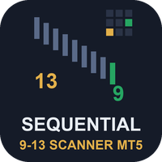
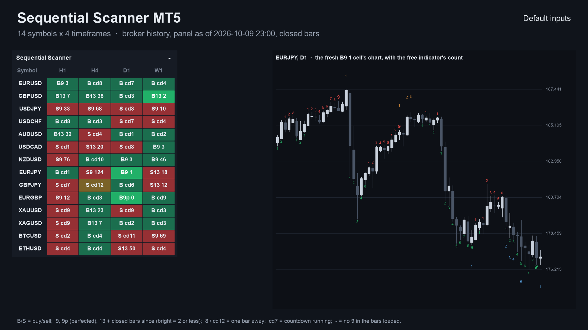
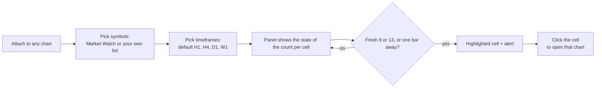
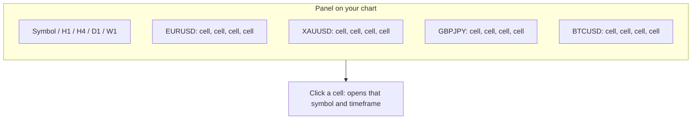
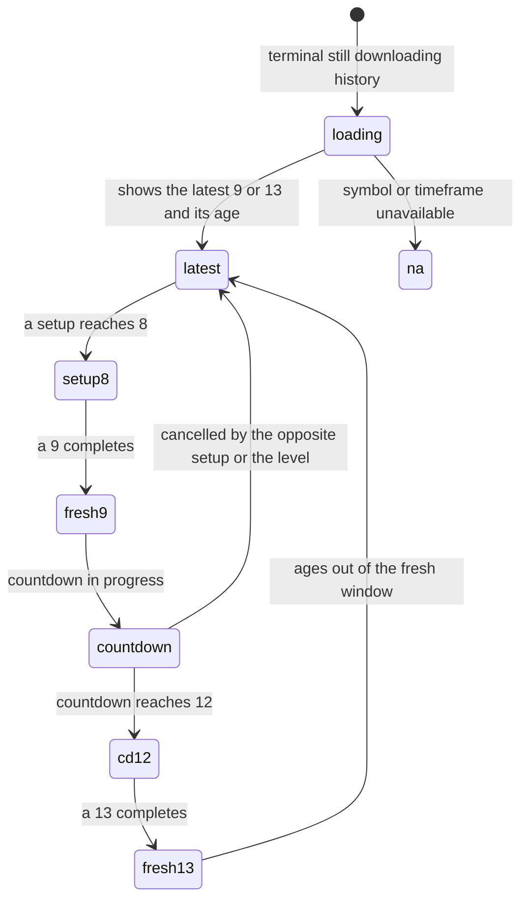
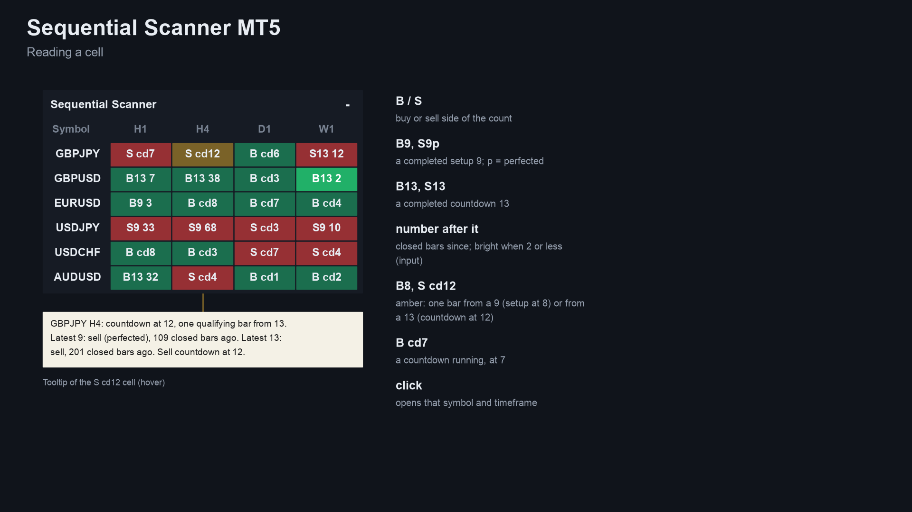
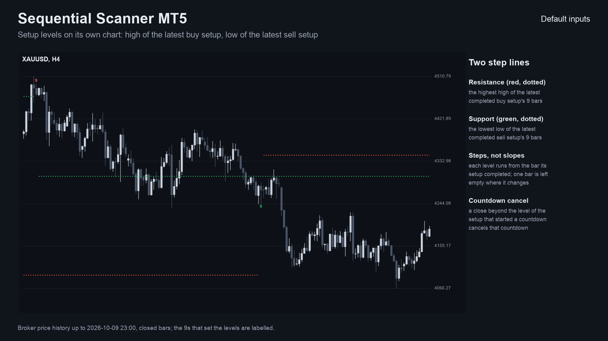
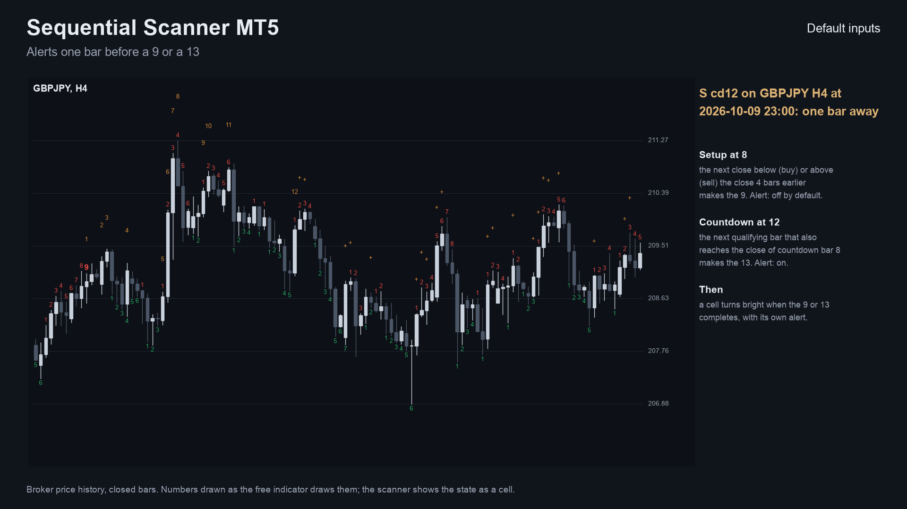
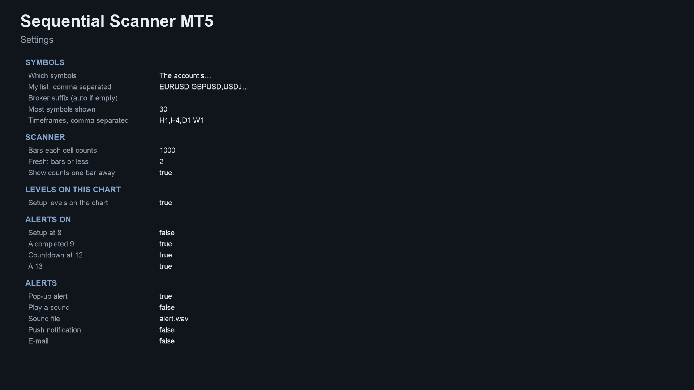
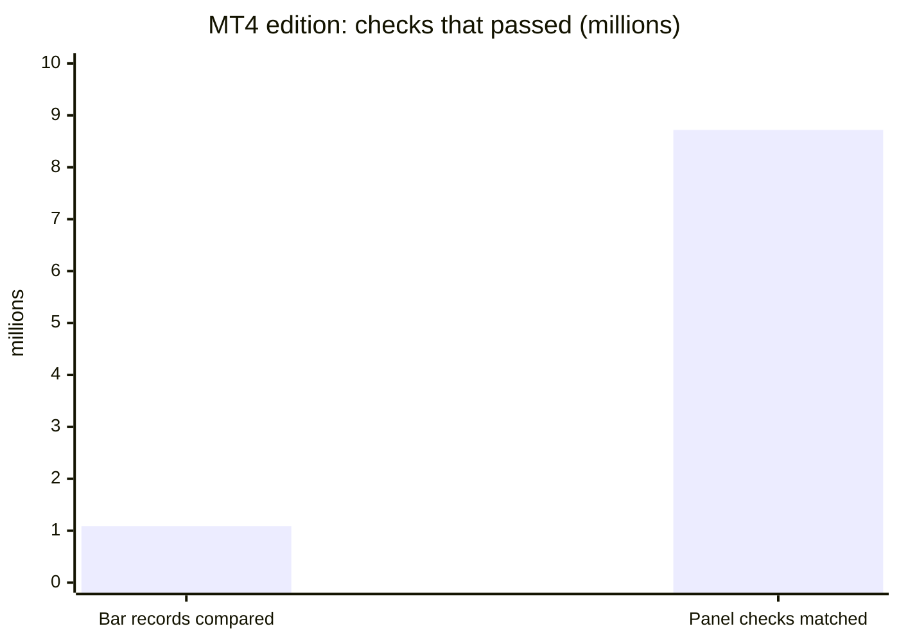

# Sequential Scanner (MetaTrader 5 and MetaTrader 4)

A panel indicator that runs the **9-13 sequential count on many symbols and timeframes** at once. Each cell shows a fresh 9 or 13, a count one bar from completing, or a countdown in progress, and the panel sends an alert.

> **This is a showcase repository: documentation and images only. There is no source code here.** The product is sold on
> the MQL5 Market. The free indicator it relates to has public source:
> [allanninal/sequential-countdown](https://github.com/allanninal/sequential-countdown).

**Website:** [allanninal.dev/mql5 (indicators)](https://www.allanninal.dev/mql5/#indicators) · [MT4 editions](https://www.allanninal.dev/mql5/#mt4) · [allanninal.dev](https://www.allanninal.dev)
· **Contact:** message me on [LinkedIn](https://www.linkedin.com/in/allanninal/).

## Get it on the MQL5 Market

| Product | Platform | Price | Link |
|---|---|---|---|
| **Sequential Scanner** | MT5 | paid | <https://www.mql5.com/en/market/product/201877> |
| **Sequential Scanner MT4** | MT4 | paid | <https://www.mql5.com/en/market/product/202422> |
| Sequential Countdown (source on GitHub) | MT5 | free | <https://www.mql5.com/en/market/product/201875> |
| Sequential Countdown MT4 (source on GitHub) | MT4 | free | <https://www.mql5.com/en/market/product/202363> |

The paid product is standalone: you do not need to install the free indicator to use it. Details, current price and the
Strategy Tester demo are on the Market pages.

## What it does

- A panel on the chart with **symbols as rows and timeframes as columns** (Market Watch symbols, or your own list).
- **In each cell:** a fresh 9 or 13 (`B13 1`, `S9p 0`; `p` = perfected), a setup at 8 or a countdown at 12 (one bar from completing), a countdown in progress (`B cd7`), or otherwise the latest 9 or 13 with its age. The tooltip gives the full state.
- **Levels** on its own chart: the high of the latest buy setup and the low of the latest sell setup, drawn as steps from the bar each setup completed.
- **Alerts** at a 9 and a 13, and optionally one bar before (setup at 8, countdown at 12): pop-up (on by default), sound, push notification, e-mail. Nothing is sent while history loads, never twice for the same cell and bar, and not in the Strategy Tester. Alerts of the same second come as one message.
- **Click a cell** to open that symbol and timeframe.
- **Closed bars only.** A cell does not change after its bar has closed. It places no orders.
- The same stated variant of the count as the free indicator, so the panel and the chart always agree.

### The grid at a glance

Each cell is one symbol on one timeframe. You read a whole watchlist in a single look instead of flipping through charts.

### What a cell can show

| | |
|---|---|
|  |  |
|  |  |
|  |  |

MT4 edition screenshots: [panel on a chart](images/mt4/01-scanner-on-chart.png), [how to read a cell](images/mt4/02-reading-a-cell.png), [setup levels](images/mt4/03-setup-levels.png). Some screenshots are illustrations built from broker history, not terminal captures.

## Who it is for

Traders who use the 9-13 count on several symbols. If you watch one chart, the free [Sequential Countdown](https://www.mql5.com/en/market/product/201875) numbers the whole count there.

## Why it was built

- The 9-13 count is a long-standing method, and the free indicator covers one chart at a time.
- Our October 2026 market research found a small niche: few indicators for this count on the Market and few freelance requests. A scanner is the usual way people use the method across a watchlist, so this is a smaller-scale tool for people who already use it, not a claim of mass demand.
- The count has several published variants, so the exact one is stated in the free repository and in the Market listing.
- Design rule carried over from the free indicator: trust. Cells use closed bars only, so what you saw does not change.

## How it was checked (results)

The count is the one in the free indicator, which matched an independent Python calculation on every bar and passed an every-tick repaint test. For the scanner, every count, 9, 13 and level value was compared with the same Python calculation.

| Check | MT5 edition | MT4 edition |
|---|---|---|
| Test files compared | 16 (the engine and the cell loader, four symbols, several timeframes) | 108 (EURUSD, GBPJPY, XAUUSD, BTCUSD x M15, H1, H4, D1, two settings) |
| Result | 0 mismatches | 1,091,786 bar records compared, 0 differences |
| Panel counts vs the test's own cells | - | 8,718,672 checks matched after start-up |
| Cells using the forming bar | none | none |

These are code checks, not trading results.

## Honest limits

- A scanner shows the state of a technical rule. It does not predict the market, and a 9 or 13 is a count, not a signal. No profit or accuracy claim is made.
- The count has variants; other tools cancel, restart or qualify it differently, so their numbers will differ.
- It is an indicator: it places no orders and manages no risk.
- It needs the terminal running to alert, and push needs your MetaQuotes ID set up in the terminal.
- The source is not published; this repository documents what the product does and the results of its checks.

## Free vs paid

| | Sequential Countdown (free) | Sequential Scanner (paid) |
|---|---|---|
| Scope | one chart | many symbols x timeframes in one panel |
| Output | setup and countdown numbers, perfected 9s, 13 arrows | cells with fresh or near-complete counts, levels |
| Alerts | pop-up, sound, push, e-mail (9 and 13) | pop-up, sound, push, e-mail |
| MT5 | [201875](https://www.mql5.com/en/market/product/201875) | [201877](https://www.mql5.com/en/market/product/201877) |
| MT4 | [202363](https://www.mql5.com/en/market/product/202363) | [202422](https://www.mql5.com/en/market/product/202422) |
| Source | [public on GitHub](https://github.com/allanninal/sequential-countdown) | not published |

---

**Website:** [allanninal.dev/mql5](https://www.allanninal.dev/mql5/#indicators) · [MT4](https://www.allanninal.dev/mql5/#mt4) · [allanninal.dev](https://www.allanninal.dev)
· Questions: message me on [LinkedIn](https://www.linkedin.com/in/allanninal/). All rights reserved, see [LICENSE](LICENSE).
Copyright 2026 Allan Niñal (https://www.allanninal.dev/mql5). All rights reserved.

This repository contains documentation and images only; it contains no source code. The text and images may not be
copied, redistributed or used commercially without written permission. The Sequential Scanner products themselves are
distributed only through the MQL5 Market under the Market's own terms.
